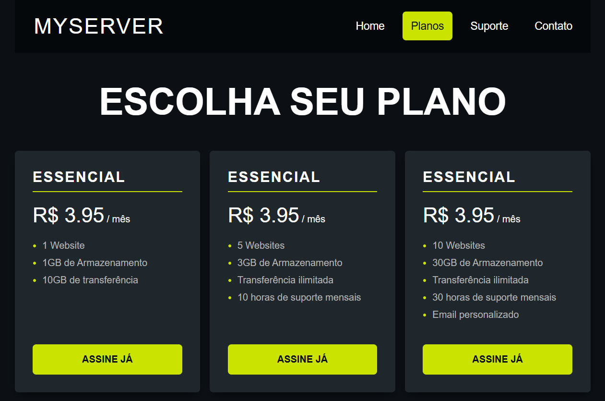

# MyServer - Tabela de Preços e Planos

Projeto desenvolvido durante aula prática (prática guiada pelo instrutor) para estudo de conceitos avançados de layout com CSS.

## 🚀 Tecnologias e Conceitos Estudados
- **Flexbox (`flex-grow`):** Aplicado no alinhamento vertical dos botões no rodapé dos cards[cite: 3].
- **Pseudo-elementos e Pseudo-classes:** Utilizados para estilização de detalhes e efeitos de interação.
  - **Pseudo-elemento:** Usado para alterar a cor dos marcadores (*bullets*) das `<li>`.
  - **Pseudo-classe:** Usada com o estado `:hover` para alterar a estilização de um elemento ao passar o ponteiro do mouse por cima.

  